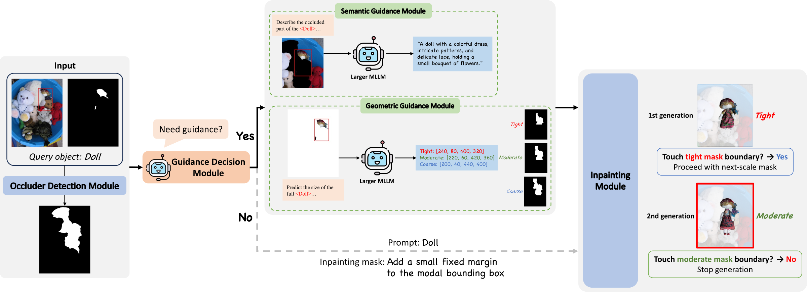

# AmodalCG: Integrating Multimodal Large Language Model Knowledge into Amodal Completion

Official implementation of **AmodalCG** ([arXiv:2603.28333](https://arxiv.org/abs/2603.28333)).

AmodalCG uses a Multimodal Large Language Model (MLLM) to guide amodal completion. It first decides
whether a target object is occluded heavily enough to need guidance. When it is, the MLLM estimates the
**extent** of the full object (bounding boxes) and describes the **content** of the missing region (a text
prompt). A visual generative model then completes the object using this guidance. Because the guidance can be
wrong, the completion is refined iteratively over boxes of increasing size.

<p align="center">
  <a href="assets/mainfigure.pdf"></a>
</p>

## Installation

```bash
git clone --recursive https://github.com/yoon6503/AmodalCG.git
cd AmodalCG

conda create -n amodalcg python=3.10 -y
conda activate amodalcg
pip install torch torchvision   # pick the build matching your CUDA version
pip install -r requirements.txt
pip install -e .
```

If you cloned without `--recursive`, run `git submodule update --init` to fetch
[InstaOrder](https://github.com/POSTECH-CVLab/InstaOrder), which is used to find occluders.

### Checkpoints

Put the following under `checkpoints/`:

| Model | File | Source |
|---|---|---|
| SAM ViT-H | `sam_vit_h_4b8939.pth` | [download](https://dl.fbaipublicfiles.com/segment_anything/sam_vit_h_4b8939.pth) |
| InstaOrderNet<sup>o,d</sup> | `InstaOrder_InstaOrderNet_od.pth.tar` | from `InstaOrder_ckpt.zip` ([Google Drive](https://drive.google.com/file/d/1_GEmCmofLSkJZnidfp4vsQb2Nqq5aqBU/view?usp=sharing)) |

Stable Diffusion 2 inpainting and InternVL3.5-8B are downloaded from the Hugging Face Hub on first use. The
original `stabilityai/stable-diffusion-2-inpainting` repository is no longer available, so the default is the
community mirror [`sd2-community/stable-diffusion-2-inpainting`](https://huggingface.co/sd2-community/stable-diffusion-2-inpainting).
Use `--sd_model` to point to a local copy instead.

The Geometric and Semantic Guidance Modules call GPT-4o through the OpenAI API, so set `OPENAI_API_KEY`.

## Data

Every dataset is described by a `manifest.jsonl` file with one target object per line. Paths are relative to the dataset root:

```json
{"id": "00002", "image": "test2014/COCO_test2014_000000000027.jpg", "modal_mask": "modal_mask/00002_COCO_test2014_000000000027_Cycle.png", "amodal_mask": "amodal_mask/00002_COCO_test2014_000000000027_Cycle.png", "category": "Cycle"}
```

`amodal_mask` is only needed for evaluation. `category` is optional; when it is missing, the category predicted by the Guidance Decision Module is used.

**COCO-A.** Download the COCO 2014 test images and the [COCOA annotations](https://github.com/Wakeupbuddy/amodalAPI), then:

```
data/COCOA/
  test2014/
  annotations/COCO_amodal_test2014.json
```

```bash
python tools/prepare_cocoa.py --root data/COCOA
```

**BSDS-A, MP3D-A, Occluded / Separated COCO.** These datasets come as one modal mask (and one ground-truth
amodal mask) per target. Use `tools/make_manifest.py` to build the manifest. It takes a text file that lists
the image of each mask, in sorted mask order:

```bash
python tools/make_manifest.py --root data/MP3D --image_dir mp3d_eval --modal_dir modal_mask \
    --amodal_dir gt_mask --image_list MP3D_img_filenames.txt
```

## Usage

The pipeline runs in stages. Every stage writes a jsonl or PNG cache and resumes if interrupted.

```bash
DATA=data/COCOA
OUT=outputs/cocoa

# 1. Occluder masks (SAM + InstaOrder)
python scripts/estimate_occluders.py --data_root $DATA --output_dir $OUT/occluders

# 2. Guidance Decision Module (InternVL3.5-8B)
python scripts/guidance_decision.py --data_root $DATA --output $OUT/decisions.jsonl

# 3. Geometric and Semantic Guidance Modules (GPT-4o); only targets flagged in step 2 are queried
python scripts/gpt4o_guidance.py --task geometric --data_root $DATA \
    --decisions $OUT/decisions.jsonl --output $OUT/boxes.jsonl
python scripts/gpt4o_guidance.py --task semantic --data_root $DATA \
    --decisions $OUT/decisions.jsonl --occluder_dir $OUT/occluders --output $OUT/prompts.jsonl

# 4. Guided completion with multi-scale refinement
python scripts/run_amodalcg.py --data_root $DATA --output_dir $OUT \
    --decisions $OUT/decisions.jsonl --boxes $OUT/boxes.jsonl --prompts $OUT/prompts.jsonl \
    --occluder_dir $OUT/occluders
```

`run_amodalcg.py` writes:

- `amodal_completions/<id>.png`: the inpainted image
- `amodal_masks/<id>.png`: the predicted amodal mask
- `amodal_white/<id>.png`: the completed object on a white background
- `results.jsonl`: the prompt, final box, and number of scales tried for each target

Step 1 is optional. If `--occluder_dir` has no mask for a target, `run_amodalcg.py` estimates it on the fly.

### Evaluation

```bash
# Amodal segmentation (COCO-A, BSDS-A, MP3D-A): mIoU overall and per occlusion level
python scripts/eval_miou.py --data_root $DATA --pred_dir $OUT/amodal_masks

# Occluded object recognition (Occluded / Separated COCO): CLIP zero-shot Top-1 / Top-3
python scripts/eval_clip.py --data_root data/OOR/occluded --pred_dir outputs/oor_occluded/amodal_white
```

### Python API

```python
from amodalcg import AmodalCG, Guidance
from amodalcg.occluders import OccluderEstimator, load_sam

sam = load_sam("checkpoints/sam_vit_h_4b8939.pth")
model = AmodalCG(sam, occluder_estimator=OccluderEstimator(sam, "checkpoints/InstaOrder_InstaOrderNet_od.pth.tar"))

guidance = Guidance(prompt="a brown dog lying down, hind legs and tail",
                    boxes=[[120, 80, 400, 330], [100, 60, 430, 360], [80, 40, 460, 390]])  # tight, moderate, coarse
result = model.complete(image, modal_mask, guidance)  # image: HxWx3 uint8, modal_mask: HxW {0, 1}
result.image, result.amodal_mask
```

## Acknowledgements

This code builds on [Stable Diffusion](https://github.com/Stability-AI/stablediffusion),
[Segment Anything](https://github.com/facebookresearch/segment-anything),
[InstaOrder](https://github.com/POSTECH-CVLab/InstaOrder),
[InternVL](https://github.com/OpenGVLab/InternVL), and
[Amodal Completion via Progressive Mixed Context Diffusion](https://github.com/k8xu/amodal).
The clean background image `assets/gray_wallpaper.jpeg` is taken from the latter.

## Citation

```bibtex
@article{yun2026amodalcg,
  title   = {Integrating Multimodal Large Language Model Knowledge into Amodal Completion},
  author  = {Yun, Heecheol and Yang, Eunho},
  journal = {arXiv preprint arXiv:2603.28333},
  year    = {2026}
}
```
